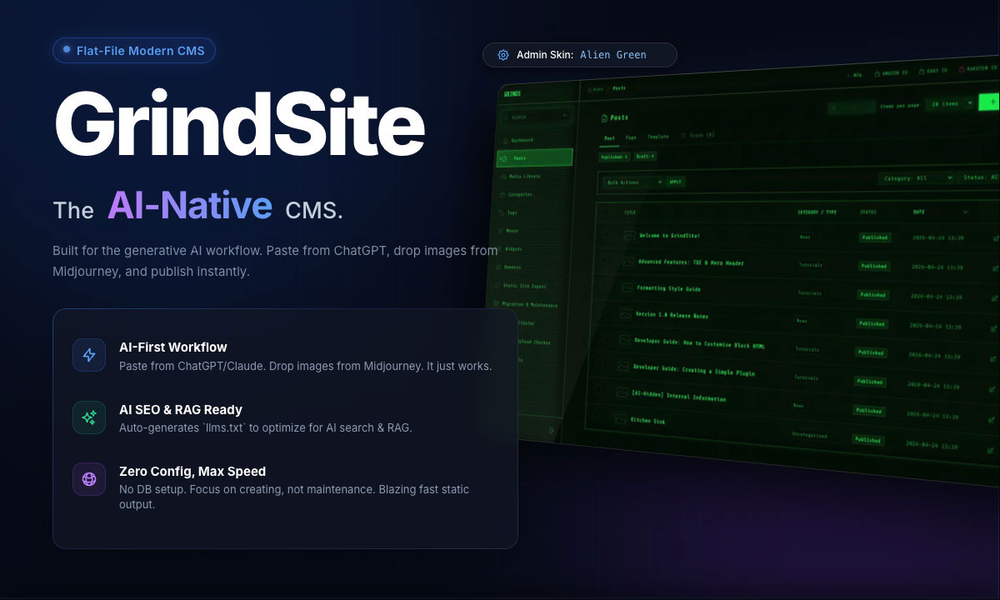

# GrindSite Core v1.8.0



**The CMS built for the Generative AI workflow.**
**生成AI時代のワークフローのために作られたCMS。**

**✨ [Admin Skins Preview / 管理画面スキンプレビュー](https://grindworks.github.io/grind-site/)**

[](https://www.php.net/)
[](#-key-features)
[-green.svg)](#-license--support-policy)
[](https://github.com/grindworks/grind-site/releases)

---

### 🌐 Language

- **[English](#english)**
- **[日本語 (Japanese)](#japanese)**

---

<a id="english"></a>

## 🇺🇸 English

GrindSite Core is the AI-Native CMS, meticulously engineered for the modern content creator's workflow. It eliminates tedious setup and maintenance, allowing you to move from idea to publication at the speed of thought.

Paste content directly from **ChatGPT, Claude, or Gemini**. Drop images from **Midjourney or DALL-E**. GrindSite Core intelligently structures everything into clean, editable blocks. Once published, your site is automatically optimized for AI search engines (`llms.txt`), ensuring your content is discovered and understood.

### ✨ Key Features

- **AI-First Workflow:**
  - **Smart Paste:** Paste Markdown, rich text, or even raw HTML from any source (ChatGPT, Claude, Gemini, Notion). GrindSite Core instantly converts it into structured blocks.
  - **Clipboard Image Upload:** Paste images directly from your clipboard into the editor. They are automatically converted to WebP and uploaded.
  - **AI Image Metadata:** Automatically detects and credits images generated by DALL-E or Midjourney.
- **AI SEO & RAG Optimized:**
  - **`llms.txt` Generation:** Automatically creates `llms.txt` and `llms-full.txt` (a full-site Markdown archive), making your content perfectly crawlable and understandable for AI search engines like Google AI Overviews, Perplexity, and RAG applications.
  - **Markdown Export:** Export your entire site as clean Markdown files, perfect for local AI analysis or migrating.
- **Creator-Focused Experience:**
  - **Zero Configuration:** No database setup. No complex dependencies. Just upload and create. Runs on a portable SQLite file.
  - **Intuitive Block Editor:** A beautiful, fast editor that lets you focus on your content.
  - **Admin Skins:** Customize the look and feel of your admin panel to match your mood or brand.
- **Robust & Secure Foundation:**
  - **Static Site Generation (SSG):** Export your site as pure HTML for maximum speed and security. Includes CLI support for CI/CD automation.
  - **Content Protection:** Secure specific content blocks with AES-256 encrypted passwords.
  - **Extensible:** A powerful plugin system and REST API allow for headless or extended functionality.
- **Secure:** Admin panel protected by robust authentication, CSRF checks, and an optional **Two-Factor Authentication (2FA)** plugin.
- **Enterprise Security:** Includes optional Institutional Grade plugins for Strict Session Management (anti-hijacking) and Immutable Audit Logging.
- **Spam & DoS Protection:** Built-in lightweight Rate Limiting plugin protects your APIs and contact forms without database locks.
- **Monetization Ready:** Beautiful Amazon, eBay, and Rakuten Affiliate product card shortcodes supported out of the box via bundled plugins.

### 📦 Installation

1. Download the latest source code (ZIP) from the **[Releases](https://github.com/grindworks/grind-site/releases)** page or "Code > Download ZIP".
2. **Important:** Upload **only the contents of the `src` folder** to your web server's public directory.
   _(Do not upload the `tools` folder or `README.md` to your public server.)_
3. Access the site URL in your browser.
4. The installer will launch automatically. Follow the instructions to set up your admin account.

### 🔒 Two-Factor Authentication (2FA)

GrindSite Core includes a built-in Email OTP (One-Time Password) plugin for enhanced security.
To enable 2FA:

1. Go to "Settings > Mail" in the admin panel and configure your SMTP settings.
2. Go to the "Plugins" menu in the admin panel and enable the "Mail OTP (2FA)" plugin.

### ⚠️ License & Support Policy

GrindSite Core is **free to use**, for personal or commercial purposes, on any number of websites — including public production servers. No license key or purchase is required. See [`LICENSE.txt`](LICENSE.txt) for the full terms (redistributing the software itself is not permitted).

Third-party open source components bundled with GrindSite Core are licensed under their own terms. See [`THIRD_PARTY_LICENSES.txt`](THIRD_PARTY_LICENSES.txt).

#### 🚫 Support Policy (Please Read Before Opening an Issue)

> **⚠️ NO TECHNICAL SUPPORT is provided.**
> However, **Bug Reports are welcome!** We appreciate your help in making GrindSite Core stable.

- **🐛 Bug Reports:** Please use [GitHub Issues](https://github.com/grindworks/grind-site/issues).
- **💬 Questions & Community:** Please use [GitHub Discussions](https://github.com/grindworks/grind-site/discussions).

**Note:** Issues regarding feature requests, "how-to" questions, or server configuration help will be closed. Please use the Discussions forum for those topics.

**Before opening an Issue, you MUST confirm ALL of the following:**

1. You are using the **latest version** of GrindSite Core.
2. The issue is a **bug in GrindSite Core itself**, not a server configuration or hosting problem.
3. You can provide **exact steps to reproduce** the issue.
4. You have searched **existing Issues** for duplicates.

_This project is maintained by an independent developer. These boundaries exist to keep the project alive and the code quality high. Thank you for your understanding._

---

### 🔄 Workflow (Local ⇔ Production)

GrindSite Core is designed for easy synchronization.

1.  **Develop Locally:** Create content and customize themes on your local machine.
2.  **Deploy:** Upload the modified files and the database in `data/` (`grinds_*.db`) to your production server via FTP.
3.  **Update:** Download the latest version from GitHub and overwrite the core files manually, or use the "One-Click Update" feature from the admin panel.

### ⬆️ Updating

Before any update, create a database backup in **Settings → Backup**.

#### One-click update (Settings → Update)

The updater overwrites GrindSite Core's files with the new version. It never changes `config.php`, `data/` (your database and backups), `assets/uploads/` or `.htaccess` files.

The option **"Do not update themes and skins"** works as follows (v1.7.4 and later):

| Option | Bundled themes and skins on your site | Bundled themes and skins not on your site |
| :--- | :--- | :--- |
| **Unchecked** (default, recommended) | Updated, including their security fixes. Before a file is overwritten, its previous version is saved to `data/theme_backups/<date_time>/`. The five most recent folders are kept. | Not added |
| **Checked** | Not changed. Security fixes for themes and skins are **not** applied. | Not added |

Themes and skins that are not bundled with GrindSite Core (for example, a theme you created) are never changed by an update.

> [!IMPORTANT]
> The update is performed by the version that is **currently installed**. When you update **from v1.7.3 or earlier**, that version's behavior applies:
> - The option is labeled "Do not update/add themes and skins" and is **checked** by default. While checked, themes and skins are not updated.
> - If you uncheck it, all bundled themes and skins are overwritten, deleted ones are restored, and **no copies are saved** to `data/theme_backups/`. Copy any bundled theme you edited before updating.
>
> The behavior in the table above applies once your site runs v1.7.4 or later.

#### Bundled plugins

Enabling a bundled plugin renames `plugins/_name.php` to `plugins/name.php`, and an update adds the new version as `_name.php` again. From v1.8.1, GrindSite Core then replaces your enabled `name.php` with the new version and removes the duplicate `_name.php`, but only if you have not edited `name.php`. If you edited it (for example to set allowed IPs or passwords), it is left unchanged and the **Plugins** page shows a notice: copy your settings into `_name.php`, delete `name.php`, then enable the new version.

#### Manual update

Upload the contents of the release zip over your installation, except `install.php`. The zip does not contain `config.php` or `data/`, so those stay as they are.

A manual update overwrites all bundled themes and skins and does not save copies, so copy any bundled theme you edited first.

#### Customizing themes

Do not edit bundled themes directly. Duplicate the theme folder under a new name and edit the copy; see [`src/theme/README.md`](src/theme/README.md).

### 🔌 Completely Offline / Intranet Usage

GrindSite Core can be installed and run on a closed network with no internet access. The libraries it needs are bundled and always loaded from your server:

- **Admin panel:** Alpine.js, Flatpickr, Chart.js
- **Themes:** Alpine.js
- **Blocks:** KaTeX (Math blocks) and Prism.js with all language definitions (Code highlighting)

For a fully offline site, also check **"Offline Mode (Local Fallback)"** in the installer, or **Settings → Theme → "Disable External Assets (Local Fallback)"** later. This stops themes from loading Google Fonts and from falling back to a CDN. Some themes then show their maintenance page with simplified styling.

These features still need the internet: QR Code, Map and Embed blocks, link cards, the avatar in the nexus-profile theme and update checks. Password-protected blocks need HTTPS (or `localhost`), because browsers only allow the Web Crypto API there.

### 🚚 Server Migration & Directory Move

GrindSite Core works simply by moving files, but please follow these steps when migrating:

1. **Backup First (Crucial):** Before moving, always download a database backup from the "Settings > Backup" menu in the admin panel.
2. **Log In to Admin Panel:** After moving, access the admin login page (`/admin/login.php`) at the new URL. The system will detect the URL change and automatically clear old page caches.
3. **Check Dashboard Alerts:** If you see warnings like "URL Rewrite Error" on the dashboard, follow the instructions to run the auto-fix tool in the "Migration Checklist".
4. **For SSG Users:** If you use the Static Site Generator (SSG) for external hosting, you must run a "Full Export (Rebuild)" instead of a "Diff Export" to apply the new URL across all pages.
5. **Check Permissions:** Ensure that the `data/` and `assets/uploads/` directories retain their write permissions (e.g., 775 or 755) on the new server.

### 💻 CLI Tool (For Developers)

GrindSite Core includes a built-in command-line tool for local development or SSH environments.

```bash
# Show system status
php bin/grind.php status

# Clear page caches
php bin/grind.php cache:clear

# Reset admin password (Useful if locked out)
php bin/grind.php user:reset-password admin NewPassword123

# Create a database backup
php bin/grind.php backup:create

# Build Static Site (SSG)
php bin/grind.php ssg:build
```

### 🆘 Troubleshooting

**Q. Why do my `<iframe>` or `<script>` tags disappear when I save a post?**

**A.** For security (XSS prevention), GrindSite Core automatically removes `<iframe>` and `<script>` tags from untrusted domains. Services like YouTube, X, and Google Maps are allowed by default. To allow other external services, please add their domains to the **"Allowed iframe domains"** list in the admin Settings.

**Q. I don't use the API. Is it safe to leave it? How can I disable it?**

**A.** The default APIs are read-only and only expose public data, so they are safe. However, it's a security best practice to disable any unused features. You have two options:

1.  **Delete the `api` folder:** This is the simplest and most secure method if you are sure you won't use the API.
2.  **Block access via `.htaccess`:** If you want to keep the files but block access, open `src/api/.htaccess` and uncomment the `Require all denied` block.

**Q. Getting "500 Internal Server Error" or cannot use rescue tools?**

**A.** Some shared hosting servers do not allow the `Options` directive in `.htaccess`.
Try commenting out the following line in `.htaccess`:

```apache
# Options -MultiViews
```

**Q. Cannot access admin panel after moving folder (404/500 Error)?**

**A.** The `RewriteBase` in `.htaccess` might be mismatching.
Open `src/.htaccess` and uncomment the `RewriteBase` line.
_(During installation, the correct path is automatically detected and commented out for you.)_

```apache
# RewriteBase /grind-site/src/
# (e.g. if placed in /subdir/ -> RewriteBase /subdir/)
```

**Q. Common "Landmines" when migrating or operating on shared hosting?**

**A.** Here are 4 high-priority points to keep in mind:

1.  **`.htaccess` Options Prohibition (Common 500 Error):**
    - **Symptom:** Immediate "500 Internal Server Error" after upload.
    - **Cause:** Some shared hosting providers may prohibit the `Options` directive.
    - **Fix:** Comment out `Options -MultiViews` in `src/.htaccess`.
2.  **SQLite WAL Mode & Shared Drives (NFS):**
    - **Symptom:** "database is locked" error when saving articles.
    - **Cause:** WAL mode may fail on network shared drives (NFS) used by some shared hosts.
    - **Fix:** Set `ENABLE_WAL_MODE` to `false` in `config.php`.
3.  **WAF (Web Application Firewall) 403 Forbidden:**
    - **Symptom:** "403 Forbidden" when clicking "Save" in the admin panel.
    - **Cause:** WAF may misidentify tags like `<script>` or `<iframe>` as XSS attacks.
    - **Fix:** Temporarily disable WAF or exclude relevant signatures in your hosting control panel.
4.  **Memory Limits & Missing PHP Modules:**
    - **Symptom:** White screen when uploading large images or running SSG/Backup.
    - **Cause:** Low `memory_limit` (e.g., 128M) or missing extensions like `zip` or `dom`.
    - **Fix:** Increase `memory_limit` to 256M/512M and enable `zip`/`dom` modules in PHP settings.

### 🌐 Nginx Configuration

If you are using Nginx, please add the following rules to your server block to protect sensitive files and enable routing.
A sample configuration file is included in the `src` directory as `nginx.conf.sample`.

> [!IMPORTANT]
> You **must** adjust the `fastcgi_pass` path (e.g., `unix:/var/run/php/php8.3-fpm.sock`) to match your server's actual PHP-FPM configuration. Using the wrong path will result in a "502 Bad Gateway" error.

<details>
<summary><strong>Click to view Nginx Configuration Sample</strong></summary>

```nginx
server {
    index index.php index.html;
    client_max_body_size 50M;

    # Security Headers
    # Handled by PHP to avoid duplication
    # add_header X-Frame-Options "SAMEORIGIN" always;
    # add_header X-Content-Type-Options "nosniff" always;
    # add_header Referrer-Policy "strict-origin-when-cross-origin" always;

    # Dynamic robots.txt/sitemap.xml/llms.txt
    location = /robots.txt {
        try_files $uri /robots.php;
        access_log off;
        log_not_found off;
    }
    location = /sitemap.xml {
        try_files $uri /sitemap.php;
        access_log off;
        log_not_found off;
    }
    location = /llms.txt {
        try_files $uri /llms.php;
        access_log off;
        log_not_found off;
    }
    location = /llms-full.txt {
        try_files $uri /llms-full.php;
        access_log off;
        log_not_found off;
    }

    # Routing
    location / {
        # NOTE: If installing in a subdirectory (e.g. /blog/), change the last parameter to /blog/index.php
        try_files $uri $uri/ /index.php$is_args$args;
    }

    # Block Sensitive Files
    # [IMPORTANT] This rule must be placed BEFORE the "location ~ \.php$" block.
    location ~ (?:^|/)(\.git|\.env|\.vscode|composer\.json|package\.json|README\.md|LICENSE(\.txt)?|config\.php|nginx\.conf\.sample|\.htpasswd|\.nginx_confirmed) {
        deny all; return 404;
    }

    # [IMPORTANT] Block Database & Log Files
    location ~ \.(db|db-wal|db-shm|db-journal|sql|log|ini|bak|old|temp|swp)$ {
        deny all; return 404;
    }

    # Block System Directories
    location ^~ /data/ {
        deny all; return 404;
    }
    location ~ (?:^|/)(lib|admin/config|admin/skins|admin/views|theme/.+/parts)/ {
        deny all; return 404;
    }

    # Block direct access to theme PHP files
    location ~ (?:^|/)theme/.*\.php$ {
        deny all; return 404;
    }

    # Block direct access to PHP files in Plugins
    location ~ (?:^|/)plugins/.*\.php$ {
        deny all; return 404;
    }

    # [SECURITY] Prevent access to rescue tools (Safety net)
    location ~ (?:^|/)tools/.*\.php$ {
        deny all; return 404;
    }
    location ~ (?:^|/)tool_.*\.php$ {
        deny all; return 404;
    }

    # [SECURITY] Prevent PHP execution and XSS in uploads directory
    location ~ (?:^|/)assets/uploads/.*\.php$ {
        deny all; return 404;
    }
    location ~ (?:^|/)assets/uploads/.*\.(svg|html|xml)$ {
        add_header Content-Security-Policy "script-src 'none'";
    }

    # PHP Handling
    location ~ \.php$ {
        include snippets/fastcgi-php.conf;
        try_files $uri =404;
        fastcgi_split_path_info ^(.+\.php)(/.+)$;

        # ↓↓↓ Adjust to your environment ↓↓↓
        fastcgi_pass unix:/var/run/php/php8.3-fpm.sock;
        # ↑↑↑ Adjust to your environment ↑↑↑

        fastcgi_param SCRIPT_FILENAME $document_root$fastcgi_script_name;
        include fastcgi_params;
    }
}
```

---

</details>

### 📂 Directory Structure

The structure of the GitHub repository is as follows. Please upload **only the contents of the `src` folder** to your server.

```text
grind-site/
├── bin/               # CLI tool (grind.php) and release script (release.sh)
├── src/               # [IMPORTANT] Upload ONLY this folder's contents to your server
│   ├── admin/         # Admin panel
│   ├── api/           # REST API endpoints
│   ├── assets/        # Static files (CSS/JS/Uploads)
│   ├── data/          # Database, logs, and cache
│   ├── lib/           # Core libraries
│   ├── plugins/       # Plugin and hook management
│   ├── theme/         # Frontend themes
│   ├── config.php     # Configuration file (auto-generated)
│   ├── index.php      # Front controller
│   ├── install.php    # Installer
│   ├── llms.php       # AI overview info (llms.txt)
│   ├── llms-full.php  # AI full markdown output (llms-full.txt)
│   ├── robots.php     # Dynamic robots.txt
│   ├── rss.php        # Dynamic RSS (feed.xml)
│   ├── sitemap.php    # Dynamic sitemap.xml
│   ├── preview_auth.php # Preview authentication file
│   ├── nginx.conf.sample # Sample Nginx configuration
│   └── LICENSE.txt    # License terms
│
├── tools/             # Emergency tools (DO NOT upload to server)
├── update.json        # Update info (for GitHub releases)
└── README.md          # This file (Top level)
```

<a id="japanese"></a>

## 🇯🇵 日本語

GrindSite Coreは、現代のコンテンツ制作者のワークフローのために設計された「AIネイティブCMS」です。
面倒なセットアップや保守作業を一切不要にし、アイデアから公開までを思考のスピードで実現します。

**ChatGPT, Claude, Gemini** からのコンテンツを直接ペースト。**Midjourney, DALL-E** の画像をドラッグ＆ドロップ。GrindSite Coreはそれらを即座にクリーンで編集可能なブロックへと変換します。公開されたサイトはAI検索エンジンに最適化され（`llms.txt`）、あなたのコンテンツが発見され、正しく理解されることを保証します。

### ✨ 主な特徴

- **AIファースト・ワークフロー:**
  - **スマートペースト:** ChatGPT, Claude, Gemini, Notionなど、あらゆるソースからMarkdownやリッチテキストをペーストするだけで、自動的に構造化されたブロックに変換します。
  - **画像クリップボードアップロード:** クリップボード上の画像をエディタに直接ペーストするだけで、自動的にWebPに変換・アップロードされます。
  - **AI画像メタデータ:** DALL-EやMidjourneyで生成された画像のメタデータを読み取り、クレジットを自動で付与します。
- **AI SEO & RAG 最適化:**
  - **`llms.txt` 自動生成:** AI検索エンジン（Google AI Overviews, Perplexity等）やRAGアプリケーションがコンテンツを正しく学習できるよう、`llms.txt` およびサイト全体のMarkdownアーカイブである `llms-full.txt` を自動生成します。
  - **Markdown一括エクスポート:** サイト全コンテンツをクリーンなMarkdownとして一括書き出し。ローカルでのAI分析や他システムへの移行に活用できます。
- **クリエイター中心の体験:**
  - **設定不要:** データベース設定も、複雑な環境構築も不要。ファイルをアップロードするだけですぐに利用可能。ポータブルなSQLiteで動作します。
  - **直感的なブロックエディタ:** コンテンツ制作に集中できる、美しく高速なエディタ。
  - **管理画面スキン:** 気分やブランドに合わせて、管理画面の見た目を自由に着せ替えできます。
- **堅牢でセキュアな基盤:**
  - **静的サイト生成 (SSG):** サイト全体を純粋なHTMLとして書き出し、最高の速度とセキュリティを実現。CI/CD自動化のためのCLIツールも完備。
  - **コンテンツ保護:** AES-256暗号化によるパスワード保護ブロックで、特定のコンテンツを安全に保護します。
  - **高い拡張性:** 強力なプラグインシステムとREST APIにより、ヘッドレス運用や機能拡張が可能です。
- **高セキュリティ:** 強固な認証、CSRF対策に加え、オプションの**2要素認証 (2FA)**プラグインで管理画面を保護。
- **エンタープライズ・セキュリティ:** セッションハイジャックを防止する厳格なセッション管理や、全操作履歴を記録する監査ログなどのプラグイン（金融・公的機関レベル）を標準同梱。
- **スパム・DoS攻撃防御:** APIやお問い合わせフォームを保護する、DBをロックしない軽量なファイルベースのレートリミットプラグインを同梱。
- **収益化対応:** Amazon、eBay、および楽天アフィリエイトの美しい商品カードを生成できるショートコードプラグインを標準同梱。

### 📦 インストール方法

1. GitHub の **[Releases](https://github.com/grindworks/grind-site/releases)** または「Code > Download ZIP」から最新版をダウンロードします。
2. **【重要】** `src` フォルダの中身**だけ**を、サーバーの公開ディレクトリにアップロードしてください。
   _（`tools` フォルダやこの `README.md` はサーバーに上げないでください）_
3. ブラウザでその URL にアクセスします。
4. インストーラーが起動するので、画面の指示に従って管理者アカウントを作成してください。

### 🔒 2要素認証 (2FA) の有効化

GrindSite Coreには、セキュリティを強化するための「メールOTP（ワンタイムパスワード）プラグイン」が標準で同梱されています。
有効化する手順：

1. 管理画面の「設定 > メール」からSMTP設定を完了させます。
2. 管理画面の「プラグイン」メニューから「メールOTP (2FA)」プラグインを有効化します。

### ⚠️ ライセンスとサポートについて

GrindSite Core は、個人・商用を問わず、公開サーバーを含む任意の数のウェブサイトで**無料で利用できます**。ライセンスキーの取得や購入は必要ありません。利用条件の全文は [`LICENSE.txt`](LICENSE.txt) を参照してください（ソフトウェア自体の再配布はできません）。

GrindSite Core に同梱している第三者のオープンソースコンポーネントには、それぞれのライセンスが適用されます。詳しくは [`THIRD_PARTY_LICENSES.txt`](THIRD_PARTY_LICENSES.txt) を参照してください。

#### 🚫 サポートポリシー（Issue を立てる前に必ずお読みください）

> **⚠️ 技術サポートは提供しておりません。**
> ただし、**バグ報告は歓迎します！** GrindSite Coreの品質向上のため、ご協力をお願いいたします。

- **🐛 バグ報告:** [GitHub Issues](https://github.com/grindworks/grind-site/issues) をご利用ください。
- **💬 質問・雑談:** [GitHub Discussions](https://github.com/grindworks/grind-site/discussions)（フォーラム）をご利用ください。

**注意:** 「使い方がわからない」「サーバー設定を教えてほしい」といった内容は Issue では受け付けておりません。Discussions をご活用ください。

**Issue を立てる前に、以下の全てを確認してください：**

1. GrindSite Core の**最新版**を使用していること。
2. サーバー設定やホスティングの問題ではなく、**GrindSite Core 本体のバグ**であること。
3. **正確な再現手順**を記載できること。
4. **既存の Issue** に同じ報告がないこと。

_本プロジェクトは個人開発者によって維持されています。サポート範囲を厳格に限定することで、コードの品質と開発の継続性を確保しています。ご理解ください。_

---

### 🔄 運用フロー（推奨）

1.  **ローカルで開発:** MAMP や XAMPP などのローカル環境で記事作成やデザイン調整を行います。
2.  **アップロード:** 変更したファイルと `data/` 内のデータベース（`grinds_*.db`）を FTP で本番サーバーへ上書きします。
3.  **アップデート:** 最新版の zip をダウンロードし手動でファイルを上書きするか、管理画面から「ワンクリック更新」を使用することでアップデート可能です。

### ⬆️ アップデート

アップデートの前に、**システム設定 → バックアップ** でデータベースのバックアップを作成してください。

#### ワンクリック更新（システム設定 → アップデート）

更新処理は、GrindSite Core のファイルを新しいバージョンで上書きします。`config.php`、`data/`（データベースとバックアップ）、`assets/uploads/`、`.htaccess` ファイルは変更しません。

**「テーマとスキンを更新しない」** の動作は次のとおりです（v1.7.4 以降）。

| オプション | サイトにある同梱テーマ・スキン | サイトに無い同梱テーマ・スキン |
| :--- | :--- | :--- |
| **チェックなし**（初期状態・推奨） | セキュリティ修正を含めて更新します。上書きする前に、更新前のファイルを `data/theme_backups/<日付_時刻>/` に保存します。保存するのは直近5回分です。 | 追加しません |
| **チェックあり** | 変更しません。テーマとスキンのセキュリティ修正は**適用されません**。 | 追加しません |

GrindSite Core に同梱されていないテーマやスキン（ご自身で作成したテーマなど）は、アップデートで変更されることはありません。

> [!IMPORTANT]
> 更新処理は、**現在インストールされているバージョン**が行います。**v1.7.3 以前から**更新する場合は、そのバージョンの動作になります。
> - オプション名は「テーマとスキンを更新・追加しない」で、初期状態で**チェックが入っています**。チェックが入ったままだと、テーマとスキンは更新されません。
> - チェックを外すと、同梱テーマとスキンはすべて上書きされ、削除したものも復活します。`data/theme_backups/` への**保存も行われません**。同梱テーマを独自に変更している場合は、更新前にコピーしておいてください。
>
> 上の表の動作になるのは、サイトが v1.7.4 以降になってからの更新です。

#### 同梱プラグイン

同梱プラグインを有効にすると `plugins/_name.php` が `plugins/name.php` に名前が変わり、アップデートでは新しいバージョンが再び `_name.php` として追加されます。v1.8.1 以降、GrindSite Core は、有効化済みの `name.php` を編集していない場合に限り、それを新しいバージョンで置き換え、重複した `_name.php` を削除します。`name.php` を編集している場合（許可するIPやパスワードの設定など）は変更せず、**プラグイン** 画面にお知らせを表示します。設定を `_name.php` に移し、`name.php` を削除してから、新しいバージョンを有効にしてください。

#### 手動での更新

リリースの zip の中身を、`install.php` を除いてサーバーに上書きアップロードします。zip には `config.php` と `data/` は含まれていないため、これらはそのまま残ります。

手動での更新では、同梱テーマとスキンはすべて上書きされ、更新前のファイルは保存されません。同梱テーマを独自に変更している場合は、事前にコピーしておいてください。

#### テーマのカスタマイズ

同梱テーマは直接編集せず、テーマのフォルダを別の名前で複製してから、複製したほうを編集してください。詳しくは [`src/theme/README_ja.md`](src/theme/README_ja.md) を参照してください。

### 🔌 完全なオフライン（イントラネット）環境での利用

GrindSite Core は、インターネットに接続できない閉じたネットワークでもインストール・運用できます。必要なライブラリは同梱されており、常にサーバー内のファイルが読み込まれます。

- **管理画面:** Alpine.js、Flatpickr、Chart.js
- **テーマ:** Alpine.js
- **ブロック:** KaTeX（数式ブロック）、全言語定義を含む Prism.js（コードハイライト）

完全にオフラインで運用する場合は、インストール時に **「オフラインモード（ローカル優先）」** をチェックするか、後から **「システム設定 → テーマ → 外部アセットを無効化（ローカルフォールバック）」** を有効にしてください。テーマが Google Fonts を読み込んだり、CDN にフォールバックしたりしなくなります。一部のテーマのメンテナンス画面は簡易的な表示になります。

次の機能はインターネット接続が必要です: QRコード・地図・埋め込みブロック、リンクカード、nexus-profile テーマのアバター、更新の確認。パスワード保護ブロックは HTTPS（または `localhost`）が必要です。ブラウザが Web Crypto API をその環境でしか許可しないためです。

### 🚚 サーバー移転・ディレクトリ移動時の手順

GrindSite Core はファイルを移動するだけで動作しますが、移転時は以下の手順を行ってください。

1. **事前にバックアップを取得する（重要）:** 移転作業前に、必ず管理画面の「設定 > バックアップ」からデータベースのバックアップ（.dbファイル）をダウンロードしておいてください。
2. **管理画面へ一度ログインする:** 移転後は、新しいURLの管理画面（`/admin/login.php`）へ必ず一度アクセスしてください。URLの変更を検知し、古いページキャッシュを自動で消去します。
3. **ダッシュボードのアラートを確認する:** 管理画面のダッシュボードに「URLリライトエラー」などの警告が出た場合は、指示に従って「Migration Checklist」から `.htaccess` の自動修正を実行してください。
4. **SSG機能を使用している場合:** 外部ホスティング用に静的書き出し（SSG）を利用している場合、URL変更を全ページに反映させるため、「差分エクスポート」ではなく必ず「フルエクスポート（再構築）」を行ってください。
5. **パーミッションの確認:** FTP等でファイルを丸ごと移動させた場合、`data/` ディレクトリと `assets/uploads/` ディレクトリの書き込み権限（775や755など）が移動先でも保持されているか確認してください。

### 💻 CLI ツール (開発者向け)

GrindSite Coreには、ローカル開発やSSH環境で利用できるコマンドラインツールが組み込まれています。

```bash
# システムステータスの表示
php bin/grind.php status

# ページキャッシュのクリア
php bin/grind.php cache:clear

# 管理者パスワードのリセット (ロックアウト時に便利です)
php bin/grind.php user:reset-password admin NewPassword123
```

### 🆘 トラブルシューティング

**Q. カスタムHTMLブロック等に入力した `<iframe>` が、保存すると消えてしまいます**

**A.** セキュリティ保護（XSS対策）のため、GrindSite Coreはシステムが許可していないドメインの `<iframe>` 等を自動的に削除する仕様になっています。YouTube、X（Twitter）、Googleマップなどはデフォルトで許可されています。特定の外部サービスを埋め込みたい場合は、管理画面の「設定」内にある **「許可するiframeドメイン」** にそのドメインを追加してください。

**Q. API機能は使いませんが、そのままでも安全ですか？ 無効化する方法は？**

**A.** デフォルトのAPIは読み取り専用で、公開済みのデータしか返さないため安全です。しかし、使わない機能を無効化するのはセキュリティのベストプラクティスです。以下のいずれかの方法で無効化できます。

1.  **`api` フォルダごと削除する:** 最もシンプルで確実な方法です。
2.  **`.htaccess` でアクセスを遮断する:** ファイルを残したままアクセスを遮断するには、`src/api/.htaccess` を開き、`Require all denied` と書かれたブロックのコメントアウトを外してください。

**Q. 「500 Internal Server Error」が出る / 緊急ツールが使えない**

**A.** 一部のレンタルサーバー（Lolipop, Sakura など）では、`.htaccess` 内の `Options` 記述が禁止されている場合があります。
その場合、`.htaccess` ファイル内の以下の行を `#` でコメントアウトしてみてください。

```apache
# Options -MultiViews
```

**Q. フォルダ移動後に管理画面に入れない (404/500エラー)**

**A.** `.htaccess` の `RewriteBase` 設定が合っていない可能性があります。
`src/.htaccess` を開き、以下の行のコメントアウトを外し、現在のパスに合わせて書き換えてください。

```apache
# RewriteBase /grind-site/src/
# (例: /subdir/ に置く場合 → RewriteBase /subdir/)
```

**Q. サーバー移転や運用時に注意すべき「地雷ポイント」はありますか？**

**A.** プロの視点で、特にはまりやすい4つのポイントをリストアップしました。

1.  **`.htaccess` の `Options` 禁止 (500エラーの定番):**
    - **症状:** アップロード直後に「500 Internal Server Error」になる。
    - **原因:** さくらインターネットやロリポップ等では `.htaccess` での `Options` 設定が禁止されている場合があります。
    - **対策:** `src/.htaccess` 内の `Options -MultiViews` を `#` でコメントアウトしてください。
2.  **SQLiteの「WALモード」と共有ドライブの相性:**
    - **症状:** 閲覧はできるが、保存時に「database is locked」エラーになる。
    - **原因:** ネットワーク共有ドライブ (NFS) ではSQLiteのWALモードのロック機構が正常に働かないことがあります。
    - **対策:** `config.php` の `ENABLE_WAL_MODE` を `false` に設定してください。
3.  **WAF (ウェブアプリケーションファイアウォール) による403エラー:**
    - **症状:** 記事保存時に「403 Forbidden」エラーになる。
    - **原因:** エックスサーバーやロリポップ等のWAFが、HTMLタグを攻撃と誤検知して遮断しています。
    - **対策:** サーバーの管理画面からWAFを一時的に無効にするか、該当ルールを除外設定してください。
4.  **PHPのメモリ制限と拡張モジュール不足:**
    - **症状:** 画像アップロードやバックアップ実行時に画面が白くなる。
    - **原因:** `memory_limit` が低い（128M等）、または `zip` / `dom` モジュールが無効になっている。
    - **対策:** `memory_limit` を 256M 以上に引き上げ、必要なPHP拡張を有効化してください。

### 🌐 Nginx の設定

Nginx をご利用の場合は、以下の設定を server ブロックに追加して、セキュリティを確保してください。特に `assets/uploads` 以下での PHP 実行禁止は重要です。
設定例として、`src` ディレクトリ内に `nginx.conf.sample` を同梱しています。

> [!IMPORTANT]
> **重要:** `fastcgi_pass` のパス（例: `unix:/var/run/php/php8.3-fpm.sock`）は、ご利用のサーバー環境に合わせて必ず変更してください。設定が異なると「502 Bad Gateway」エラーが発生します。

<details>
<summary><strong>Nginx の設定サンプルを表示する</strong></summary>

```nginx
server {
    index index.php index.html;
    client_max_body_size 50M;

    # セキュリティヘッダー
    # PHP側で出力するためコメントアウト (重複回避)
    # add_header X-Frame-Options "SAMEORIGIN" always;
    # add_header X-Content-Type-Options "nosniff" always;
    # add_header Referrer-Policy "strict-origin-when-cross-origin" always;

    # Dynamic robots.txt/sitemap.xml/llms.txt
    location = /robots.txt {
        try_files $uri /robots.php;
        access_log off;
        log_not_found off;
    }
    location = /sitemap.xml {
        try_files $uri /sitemap.php;
        access_log off;
        log_not_found off;
    }
    location = /llms.txt {
        try_files $uri /llms.php;
        access_log off;
        log_not_found off;
    }
    location = /llms-full.txt {
        try_files $uri /llms-full.php;
        access_log off;
        log_not_found off;
    }

    # Routing
    location / {
        # サブディレクトリにインストールする場合（例: /blog/ ）は、最後のパラメータを /blog/index.php に変更してください
        try_files $uri $uri/ /index.php$is_args$args;
    }

    # Block Sensitive Files
    # [IMPORTANT] このルールは "location ~ \.php$" ブロックより前に配置する必要があります
    location ~ (?:^|/)(\.git|\.env|\.vscode|composer\.json|package\.json|README\.md|LICENSE(\.txt)?|config\.php|nginx\.conf\.sample|\.htpasswd|\.nginx_confirmed) {
        deny all; return 404;
    }

    # [IMPORTANT] Block Database & Log Files
    location ~ \.(db|db-wal|db-shm|db-journal|sql|log|ini|bak|old|temp|swp)$ {
        deny all; return 404;
    }

    # Block System Directories
    location ^~ /data/ {
        deny all; return 404;
    }
    location ~ (?:^|/)(lib|admin/config|admin/skins|admin/views|theme/.+/parts)/ {
        deny all; return 404;
    }

    # Block direct access to theme PHP files
    location ~ (?:^|/)theme/.*\.php$ {
        deny all; return 404;
    }

    # Block direct access to PHP files in Plugins
    location ~ (?:^|/)plugins/.*\.php$ {
        deny all; return 404;
    }

    # [SECURITY] Prevent access to rescue tools (Safety net)
    location ~ (?:^|/)tools/.*\.php$ {
        deny all; return 404;
    }
    location ~ (?:^|/)tool_.*\.php$ {
        deny all; return 404;
    }

    # [SECURITY] Prevent PHP execution and XSS in uploads directory
    location ~ (?:^|/)assets/uploads/.*\.php$ {
        deny all; return 404;
    }
    location ~ (?:^|/)assets/uploads/.*\.(svg|html|xml)$ {
        add_header Content-Security-Policy "script-src 'none'";
    }

    # PHP Handling
    location ~ \.php$ {
        include snippets/fastcgi-php.conf;
        try_files $uri =404;
        fastcgi_split_path_info ^(.+\.php)(/.+)$;

        # ↓↓↓ 環境に合わせて変更してください ↓↓↓
        fastcgi_pass unix:/var/run/php/php8.3-fpm.sock;
        # ↑↑↑ 環境に合わせて変更してください ↑↑↑

        fastcgi_param SCRIPT_FILENAME $document_root$fastcgi_script_name;
        include fastcgi_params;
    }
}
```
</details>

### 📂 ディレクトリ構成

GitHub リポジトリの構成は以下のようになっています。サーバーには `src` の中身のみをアップロードしてください。

```text
grind-site/
├── bin/               # CLIツール (grind.php) とリリース用スクリプト (release.sh)
├── src/               # 【重要】この中身をサーバーにアップロードします
│   ├── admin/         # 管理画面
│   ├── api/           # REST API エンドポイント
│   ├── assets/        # 静的ファイル (CSS/JS/Uploads)
│   ├── data/          # データベース・ログ・キャッシュ用
│   ├── lib/           # コアライブラリ
│   ├── plugins/       # プラグイン・フック管理
│   ├── theme/         # フロントエンドテーマ
│   ├── config.php     # 設定ファイル (自動生成)
│   ├── index.php      # フロントコントローラー
│   ├── install.php    # インストーラー
│   ├── llms.php       # AI向け概要情報 (llms.txt)
│   ├── llms-full.php  # AI向け全記事Markdown出力 (llms-full.txt)
│   ├── robots.php     # 動的 robots.txt
│   ├── rss.php        # 動的 RSS (feed.xml)
│   ├── sitemap.php    # 動的 sitemap.xml
│   ├── preview_auth.php # プレビュー用認証ファイル
│   ├── nginx.conf.sample # Nginx用設定サンプル
│   └── LICENSE.txt    # 利用規約
│
├── tools/             # 緊急用ツール (サーバーには上げないでください)
├── update.json        # アップデート情報 (GitHub配信用)
└── README.md          # このファイル (トップレベル)
```

## © Copyright

Developed by **Koji Udagawa (GRIND WORKS, Y.K.)**

### Contact & Links
- **GitHub:** [@grindworks](https://github.com/grindworks)
- **Official Website:** [grindsite.com/core](https://grindsite.com/core/)
- **Email:** contact@grindsite.com (For commercial inquiries, partnerships, and security reports)
